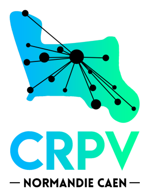

Chaque carte est publiée avec l'accord écrit du membre, qui peut le retirer à tout moment. Les coordonnées affichées sont celles du centre, pas celles des personnes.

::: {.cartes}

::: {.carte .membre}

::: {}
### [Prénom Nom]
**[Fonction : pharmacologue, praticien hospitalier]**

[Courte biographie de 50 à 80 mots, à la troisième personne.]

*Expertise :* [trois à cinq mots-clés]

[Page SigmaCV](https://sigmacv.org) · [ORCID](https://orcid.org)
:::
:::

::: {.carte .membre}

::: {}
### [Prénom Nom]
**[Fonction]**

[Courte biographie de 50 à 80 mots, à la troisième personne.]

*Expertise :* [trois à cinq mots-clés]

[Page SigmaCV](https://sigmacv.org) · [ORCID](https://orcid.org)
:::
:::

:::

Étudiant ? Voir [Enseignement et stages](enseignement.qmd).

Chaque lien SigmaCV ouvre le CV en ligne du membre, qui se met à jour seul à partir d'ORCID et des bases de données ouvertes. L'identifiant ORCID d'une carte fait aussi figurer les publications récentes du membre sur la page [Recherche et publications](recherche.qmd).
